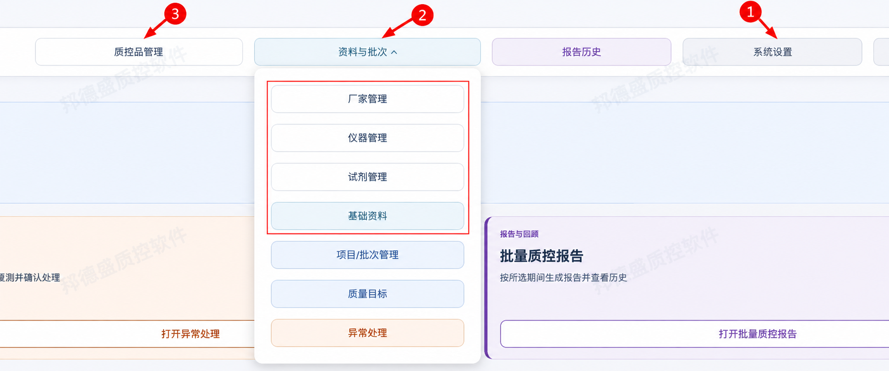

# 质控软件操作说明

第一次使用，按 **实验室信息 → 仪器试剂管理 → 新建项目** 完成首次引导。已有项目可直接选择项目和批次录入。

仪器、试剂和质控品可逐项登记，也可从Excel批量导入。

在任意页面点击顶部蓝色的**返回主页**，可直接回到**我的项目**列表。页面内的**返回项目工作台**等按钮用于返回对应页面。返回主页后，尚未保存的整组录入内容和项目筛选条件会保留，可再次打开项目继续填写；关闭应用或刷新浏览器前，请先保存需要保留的检测结果。

## 首次使用

第一次打开且尚未建立项目时，**首次引导**会自动打开。已有项目时不会自动打开，点击右上角**首次引导**可随时查看。

按**实验室信息 → 仪器试剂管理 → 新建项目**操作。点击对应按钮填写资料，保存后点**继续首次引导**。点击**下一步**或**上一步**会保留当前步骤；点击**稍后再做**后，下次从右上角继续。

- **图中 1　系统设置**：单位与报告人员。
- **图中 2　资料与批次**：厂家、基础资料、仪器、试剂。
- **图中 3　质控品管理**：产品、批号、浓度水平。

先搜索已有资料，找到后直接使用。软件已收录常用检验项目、单位、方法学和质控品名录。

1. 打开**系统设置**，填写**实验室、科室、检验员、复核员**，点击**保存设置**。
2. 打开**资料与批次 → 厂家管理**，补充需要的厂家并选择业务类别；再到**基础资料**补充缺少的检验项目、单位和方法学。
3. 打开**仪器管理**，点击**新增仪器**，填写**仪器名称、厂家、型号**，点击**保存**。同型号的多台设备分别登记。
4. 打开**试剂管理**，新增或选择试剂产品，点击**管理批号**，登记**试剂批号和效期**。
5. 打开**质控品管理**，已有产品直接选择；没有时点击**新增质控品**，填写**厂家、质控品名称、产品货号、浓度编号和实际浓度**，点击**保存**。不同厂家或货号分别登记为产品。选择产品后点击**管理批次**，按包装登记**原厂批号、效期和浓度水平**。

项目批次由所选产品和原厂批号生成，无需另填批次名称。多水平可以组合不同厂家、不同货号的产品，各水平保留自己的原厂批号和效期。

## 从Excel批量登记资料（选用）

1. 打开**资料与批次 → 单位资料准备**。也可在**系统设置**的实验室信息下方找到**单位资料准备**，点击**下载填写表或导入Excel**。下载**空白单位资料清单**；引用已有资料时，下载**已登记资料清单**。
2. 按清单说明填写实验室、科室、报告人员、检验项目、计量单位、方法学、仪器、试剂及质控品资料。**质控品产品**表填写产品的**浓度编号和实际浓度**；**质控材料**表填写批号、效期和浓度水平。
3. 上传文件，点击**审查单位资料**，核对新增和引用的资料；按提示修正后重新上传。
4. 点击**确认保存单位资料**，保存后到相应管理页面查看。

资料准备完成后，继续新建项目、确认质量目标和验证试剂批号。清单中的空白单位信息沿用原设置。

## 新建单项项目

在**项目工作台**点击**新建项目**，按三步完成。

1. **选择项目和各水平质控品。** 选择检验项目、仪器、试剂、方法学、单位、输入值类型和质控方法。在**均值和SD统计方式**选择**月度统计**或**累计统计**，旁边的问号可查看取数范围。逐水平选择**质控品产品**和**原厂批号与浓度**，按包装核对厂家、货号、浓度编号和效期。核对每个产品的适用依据；没有已登记依据时，填写**质控品确认人**和**适用依据**，点击**确认所选质控品**。全部水平选齐且不重复后，点击**下一步：设置质量要求**。
2. **设置质量目标。** 按下一节核对检测条件、限值和文件依据，填写**确认人**，勾选核对完成，点击**下一步：查看设置**。
3. **保存。** 检查项目名称、仪器、试剂、质控品、批号、全部水平和统计方式，点击**确认保存并进入录入**。

L-J 和即时法选择一个浓度水平；多水平法选择两或三个不同水平。统计方式须明确选择，用于后续参数切换，不改变首次建靶点数。保存前可返回上一步修改，取消时可选择继续填写或放弃。

浓度编号按包装核对，如 S1、S2、S3；项目中的水平顺序不改变产品原编号。

缺少质控品时，在对应水平点击**新增质控品产品**，保存产品后继续登记批号；已有产品只缺批号时，点击**登记质控品批号**。都在当前窗口填写，完成后自动选回该水平，其他已填内容保留。缺少的产品或批号会在对应下拉框标红。

已有批次在批次详情选择检验项目，点击**核对质控品**，可单独核对各水平的产品、批号及适用依据。填写或修改依据后点击**确认并保存**。需要更换产品或批号时，点击**编辑水平设置**。

缺少检验项目、仪器、试剂、方法学或单位时，展开**补充基础资料**，选择资料类型并登记。保存后回到当前设置并自动选中新资料；整组添加检验项目时，在上方选择刚登记的资料。

登记仪器、试剂或质控品时，厂家列表没有所需记录，可点击**新增仪器厂家**、**新增试剂厂家**或**新增质控品厂家**。保存厂家后会返回原填写窗口并选中该厂家，继续保存仪器、试剂或质控品。

已经打开**新增配套记录**或**编辑配套记录**时，先保存或取消这条记录，再继续项目设置。切换**多个检验项目设置**或**单检验项目快捷设置**时，当前填写的项目名称、仪器、试剂、质控品和方法会带入；按提示重新选择检验项目、水平和统计方式，并核对质量要求。

## 设置质量目标

1. 核对已带入的**检测条件**。缺项会展开并标红；需要调整时展开**修改检测条件**，检查检测技术、结果性质、尺度、用途和标本或基质。
2. 有适用数值标准时，核对来源和各水平采用的限值；没有匹配限值时，按下表填写。
3. 填写**确认人**，勾选**已确认检测方法、单位、各水平和以上质量要求填写正确**。新建项目中继续**下一步：查看设置**；已有项目点击**保存质量目标**，批次点击**确认本批次质量目标**。

按钮不可用时，补齐红框，并处理页面指出的具体冲突。新建项目中需要修改方法学、单位、输入值类型或质控品批号，点击**返回检测设置**。

| 页面显示 | 操作 |
| --- | --- |
| **引用现行数值标准** | 核对自动引用的国家或卫生行业标准及限值；页面要求时填写各水平浓度或选择水平类别。需要更严 CV 时展开**选填：实验室更严CV要求**填写。 |
| **实验室CV上限（选填，%）** | 有实验室限值时按百分数填写，留空不比较；仅用于浓度、活性、计数等原始定量结果。 |
| **选用已登记限值** | 展开后从**已登记限值**选择要求，核对来源和各水平限值。撤销时选择**不选用，直接填写**，原来填写的 CV 和文件草稿会恢复。 |
| **要求与文件依据** | 核对**实验室实际要求**；需留存文件时，填写名称、设置日期或版本，以及此要求如何用于本次检测。文字要求由实验室核查。 |

CV上限与正式期在控结果的CV比较，不用于单次失控判定。Ct、log、S/CO不提供浓度CV限值比较。L-J和多水平法的失控判定使用各自已设规则；即时法查看SI。

适用的对照要求在**对照与质控要求**中核对，定性与信号精密度条款按页面要求采用。条件尚待核实时点击**保存，稍后继续**，核实后回来确认。

参考标准按实施日期用于新确认；已确认批次和原报告保留当时的依据。

在**质量目标**页面选择检验项目后，点击**前往批次管理**，会先显示该项目的批次。选择批次后查看本批次的质量要求。各水平尚未选齐时，先返回批次详情，点击当前检验项目的**编辑水平设置**，保存全部水平后再设置质量目标。

## 验证并使用试剂批号

项目建好后，按检验项目登记试剂验证和使用时间。

这里的“批号验证”，是记录这批试剂在所选项目、仪器上的检查结论、依据、完成时间和确认人。按实验室已有的检查记录填写。

1. 打开**试剂管理**，选择试剂，点击**管理批号**，选中要使用的批号。
2. 点击**登记批号验证**，选择检验项目，填写**验证结论、依据、完成时间和确认人**，保存。
3. 验证通过后点击**切换到此试剂批号**，核对检验项目、新旧批号、启用时间和参数适用依据，再点击**确认切换所选检验项目**。首次使用按页面登记。
4. 回到录入页面，核对本次试剂批号和检测时间。

更换试剂批号时重复以上步骤。既往记录保留当时的批号。

正在 L-J、多水平法或即时法中填写检测结果时，可直接点击**登记或核对试剂批号**，打开当前检验项目的试剂资料。完成登记、验证或使用设置后，点击**返回本次结果录入**。本次尚未保存的检测时间、检测人和检测值会保留，多水平的全部水平也会保留；回来后重新核对本次试剂批号，再保存结果。后续登记或验证不会补改已经保存的检测记录。

## 录入单项结果

1. 在首页**我的项目**勾选项目，点击**打开所选项目**，再选择检验项目和批次。
2. 填写**检测时间、检测人、结果**，选择本次试剂批号。多水平法**填齐全部水平**。
3. L-J 和即时法点击**保存检测结果**；多水平法点击**保存本次检测**。
4. 在**检测记录**选择刚保存的一条，点击**查看**，核对数值、批号和判读；质控图在同一页面查看。

在**今日质控总览**选择所填检测日期，可查看当天结果和待处理异常。输入 Ct 或 log 时，按项目已经选定的类型填写。

检测时间按北京时间填写，不能晚于当前时间；补录历史结果时填写实际检测时间。整组录入和文件导入同样适用。

## 整组录入结果

一次填写本项目多个检验项目的全部水平结果，统一保存并查看各项质控判定。

1. 在所选项目内点击**整组录入**，选择质控品批号或材料组合，点击**展开本组录入**。
2. 填写**检测时间、检测人**，按检验项目和水平顺序填写结果。**从表格粘贴检测值**可把复制的内容填入录入表；**用 Excel 填写或导出本组结果**可下载填写模板或导出表中内容。上传填好的模板，**预览结果文件**会检查项目、水平、批号和检测值；**填入录入表**会把文件中的结果、时间、人员和备注填到本组表格中。
3. **检查本组结果**会检查检测值、时间、人员和实际批号，并列出需补齐或修改的项目。检查通过后，**确认保存整组**会一次保存所选检验项目的全部水平结果，并显示各项质控判定。
4. 查看保存成功的结果。下一次检测点击**再次检测，开始新一组**。

整组录入须先完成各检验项目的试剂批号验证。多水平的全部水平合计一次检测，空白格应补填真实结果。Enter、Tab 用于换格，结果在确认保存后登记。

没有可选批次时，点击**打开本项目批次设置**，补齐水平和批次资料。核对某项设置时，展开**核对实际试剂、备注和材料资料**，点击该项的**打开本项批次设置**或对应核对按钮，会打开所属批次并选中该检验项目。返回后点击**保留输入并重新核对资料**，再检查本组结果。**今日质控总览**中的**查看批次设置**也会打开所选检验项目，已填写的整组检测值会保留。

## 建立均值和标准差

默认收集 20 个有效检测点；20 点可以分布在不同天，也可以同一天多次检测。所需点数以本批次设置为准。

1. 进入批次工作台，录入结果，查看有效点数和疑似离群提示。
2. 核对疑似离群记录，需要调整时选中记录，点击**保留**或**禁用**，填写原因并确认。
3. 达到所需有效点数后核对均值和标准差。默认 20 点时，后续第 21 次进入正式期。
4. L-J 和多水平法已有检测结果文件时，可在完成建靶前选择**导入数据 → 建靶期**批量录入；完成建靶后，后续结果选择**正式期**导入。

多水平每次填齐全部水平，禁用点留在记录中，有效点数按纳入统计的结果计算。标准差为零时，核对数据并继续采集。已有厂家或人工均值、标准差时，在批次参数中填写各水平数值、依据、确认人和生效时间，确认后使用。

后续需要切换参数时：

1. 在批次详情点击**切换均值和SD**。也可打开**批号使用与追溯 → 均值和标准差管理**，选择批次后点击同名按钮。填写人工或厂家赋值时，点击**人工或厂家参数**；尚无已确认参数时点击**确认均值和标准差**。
2. 选择统计方式，核对各水平的**当前均值、当前SD、本次均值、本次SD、有效点数和统计范围**。
3. 填写**生效时间、切换依据、确认人**，勾选**已核对全部水平的新统计值和生效时间**，点击**确认切换**。

| 统计方式 | 取数范围 |
| --- | --- |
| **月度统计** | 上一个自然月的有效数据。 |
| **累计统计** | 从开始到最新记录的全部有效数据，包含本月。 |

两种方式均按同一检测系统、同一实际产品批号和同一物理水平取数，纳入有效建靶结果和正式期在控结果；多水平正式期须整次在控。质控报告的正式期统计仍按原口径。

参数候选只在主动打开切换窗口后计算；月份变化或新增数据不自动切换，也不提醒。点击**取消**保留现用参数。确认后的新参数从所选生效时间使用，旧结果保留原参数和判读。

## 即时法转入 L-J

1. 在即时法工作台录入结果，3 个有效点后查看 SI 提示。
2. 累计 20 个有效点后复核记录，点击**确认转入 L-J 法**。
3. 核对有效点数、均值、标准差及新批次，确认保存后进入对应 L-J 批次继续录入。

转入后，原即时法记录在原批次查看。建项选择的统计方式保留；在**均值和标准差管理**选择转入的 L-J 批次，可手动切换参数。即时法阶段仍按原规则计算 SI。

## 设置多个检验项目

1. 点击**新建项目 → 多个检验项目设置**，选择仪器、试剂、质控品等共同资料，点击**确认所选质控品**后保存项目。
2. 点击**整组添加检验项目**，选择已有项目或质控品适用项目，核对后保存。
3. 逐项设置质控方法、方法学、单位、输入值类型、水平数、**均值和SD统计方式**和质量目标。统计方式可在表中逐项选择，也可展开**为选中项目统一设置**批量填写。各批次逐水平选择实际产品、原厂批号、浓度和参数；需核对适用依据时点击**核对质控品**，再点击**确认项目设置**、**确认批次设置**。
4. 按各检验项目完成试剂批号验证，再进入**整组录入**。

各检验项目可使用不同质控方法和产品组合。复制或导入项目设置后，使用前核对各项质量目标及选品依据；多产品导出中的全部产品来源和覆盖明细供查阅，导入后须重新选择各水平产品、批号并确认。

项目配置 Excel 的**项目配置**工作表新增**均值和SD统计方式**列，填写**月度统计**或**累计统计**。空白项保留为待选，导入后补齐，再点击**确认项目设置**。

新建项目、添加检验项目或整组添加时，同样可以展开**补充基础资料**，在当前窗口补充缺少的资料。登记期间先保存或取消资料，再继续预览或保存项目；原来填写的项目资料和整组清单会保留。

## 查看和维护记录

1. 在**检测记录**选择日期、阶段或状态，单选一条记录，点击**查看**，核对后关闭窗口。
2. **编辑**按钮可用时，可修正检测时间、检测人和结果，填写**维护原因**后点击**保存修改**。需要调整建靶记录是否参与统计时，点击当前可用的**保留**、**禁用**或**恢复**，填写原因并确认。
3. 保存后查看有效点数和维护记录；多水平按一次检测的全部水平一起处理。

批次已确认控制参数或进入正式期后，检测时间、检测人和原始结果仅供查询；转入 L-J 后的即时法原记录也仅供查询。发现误录时，保留记录并按实验室流程登记处理。

## 处理失控并关联复测

1. 打开**资料与批次 → 异常处理**，选择检测日期，单选异常记录，点击**处理**。
2. 核对原结果和失控规则，填写**原因分析、纠正措施、处理人**，按本次情况填写患者影响评估，点击**保存处理草稿**。
3. 完成复测后回到原事项，选择后续复测，核对时间、结果、批号和参数；有变化时填写说明。
4. 填写**处理效果和依据**。**加入本次处理**会把所选文件放入附件清单；**保存处理草稿**将原因、措施、复测和附件一并保存，稍后可继续补充。
5. 点击**提交效果确认**，由确认人核对效果及依据，填写确认时间后点击**确认完成**。

复测结果和处理状态分别保留。需要补充已完成处理时新增修订，旧版本在处理历史查看。

## 导入导出数据和质控图

L-J 和多水平法在当前批次操作。

1. 导入时，在当前批次点击**导入数据**，选择**建靶期**或**正式期**，点击**下载导入模板**。
2. 填好后上传 CSV 或只有一个数据工作表的 Excel，点击**检查文件并预览**，核对检测时间、结果和实际试剂批号，再点击**确认导入**。多水平每行填齐一次检测的全部水平。
3. 导出时，点击**导出 → 检测数据**，选择检测范围、文件格式和数据日期，点击**下载检测数据**。
4. 选择**质控图**，核对当前图或正式期日期范围，点击**下载质控图（PNG）**；有分图时点击**下载总览和分图（ZIP）**。

导入的实际试剂批号留空时保存为**未记录**。文件有错误时按行号修正后重新预览；建靶期、正式期各用对应模板导入，**全部**阶段的导出文件用于汇总查看。

L-J 图和多水平的各水平分图右侧标出均值及 ±1、±2、±3SD，三组 SD 用不同颜色区分。出现**参数调整**时分段查看；**均值（末段）**对应最后一段参数。

## 生成质控报告

1. 在单项工作台打开**质控报告**，按**按月快捷**选择月份；需要其他期间时选**自选日期**，填写开始和结束日期。
2. 点击**核对报告**，检查期间、批次和检测次数，核对要采用的失控处理版本；修改版本后更新预览。
3. 点击**生成并保存报告**，下载 PDF；需要处理报告及附件原件时，点击**下载报告和附件（ZIP）**。打印后由检验员、复核员签名。
4. 一次生成多份时，打开**批量质控报告**，选择期间、仪器和项目，点击**核对待生成清单 → 生成并保存所选报告**，再点击**下载全部报告和附件（ZIP）**；失败项可单独重试。

起止当天都包含。长图分页显示，处理附录保留所选版本及其复测。报告和附件 ZIP 包含质控 PDF 和清单，有处理报告和附件时一同收入。

## 查看原报告和完整备份

1. 打开**报告历史**，选中报告，点击**查看所选报告**，再点**下载已保存的原 PDF**或**下载原报告和附件（ZIP）**。需要更新时点击**按当前数据重新生成 PDF**，按原期间另存新报告。
2. 打开**系统设置 → 数据保存与备份**。网页版点击**生成完整备份 → 下载完整备份**，把文件保存到自己的电脑；本机版点击**立即备份到默认目录**，核对成功提示和保存位置。完整备份包含检测资料、处理附件和原报告。
3. 恢复时先保留当前完整备份。网页版在**选择备份文件**中上传文件；本机版点击同名按钮选择文件。检查通过后，勾选确认项，点击**确认恢复数据**。网页恢复前请让其他使用者退出，完成后刷新页面；本机版按提示重新打开软件。

## 常见问题

- **缺少质控品产品或批号：** 在对应水平点击**新增质控品产品**或**登记质控品批号**，按包装登记；完成后自动选回该水平。已有产品的适用依据尚未确认时，点击批次详情的**核对质控品**。
- **找不到单位资料准备：** 打开**资料与批次 → 单位资料准备**，或在**系统设置**的实验室信息下方点击**下载填写表或导入Excel**。
- **没有可用试剂批号：** 在单项录入中点击**登记或核对试剂批号**，登记并验证后点击**返回本次结果录入**，核对验证时间、检测时间和效期。单项保存为**未记录**时按原记录核查；整组录入先补齐批号验证。后续登记不会补改已保存结果。
- **导入 20 行后有效点不足：** 检查禁用记录、全部水平和标准差，补齐所需有效点。
- **找不到刚保存的结果：** 选择所填检测日期，核对项目和仪器筛选。
- **提示检测时间晚于当前时间：** 核对日期和时间后重试，已填写的结果会保留；导入文件需先修正再预览。
- **保存或报告提示需要重新核对：** 保留填写内容，按提示更新资料后重新预览；附件缺失时先补齐原文件。
