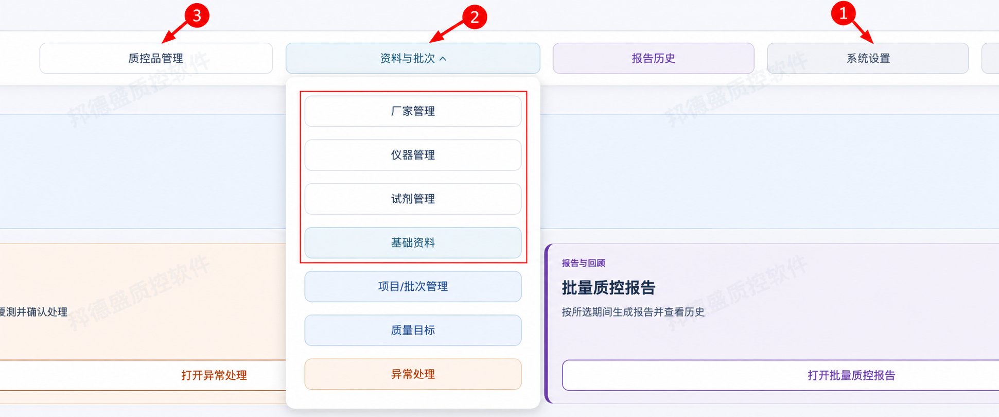
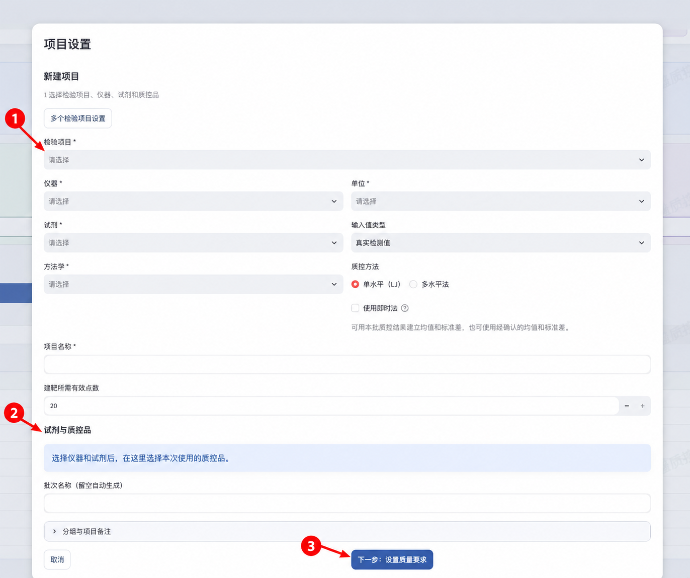
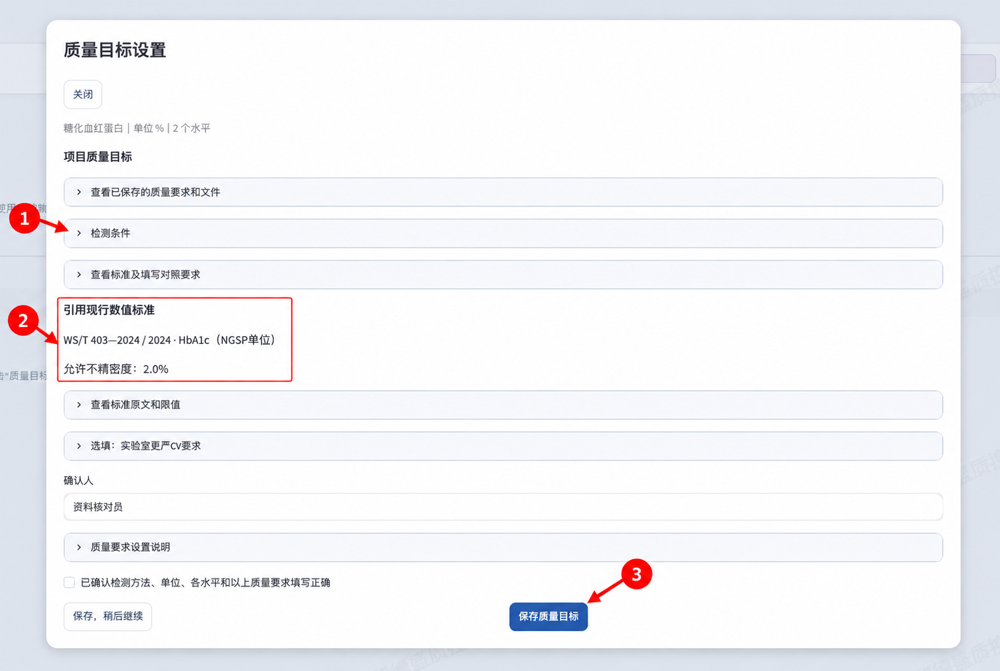

# 质控软件操作说明

第一次使用，按 **准备资料 → 新建项目 → 设置质量目标 → 验证试剂批号 → 录入结果 → 处理失控 → 报告与备份** 的顺序操作。已有项目可直接从录入开始。

资料可逐项登记，也可用单位资料清单一次准备。

## 首次使用先准备资料

第一次打开且尚未建立项目时，**首次引导**会自动打开。已有项目时不会自动打开，点击右上角**首次引导**可随时查看。

按**单位信息 → 准备资料 → 建立项目 → 开始检测**操作。点击对应按钮填写资料，保存后点**继续首次引导**。点击**下一步**或**上一步**会保留当前步骤；点击**稍后再做**后，下次从右上角继续。

- **图中 1　系统设置**：单位与报告人员。
- **图中 2　资料与批次**：厂家、基础资料、仪器、试剂。
- **图中 3　质控品管理**：产品、批号、浓度水平。

先搜索已有资料，找到后直接使用。软件已收录常用检验项目、单位、方法学和质控品名录。

1. 打开**系统设置**，填写**实验室、科室、检验员、复核员**，点击**保存设置**。
2. 打开**资料与批次 → 厂家管理**，补充需要的厂家并选择业务类别；再到**基础资料**补充缺少的检验项目、单位和方法学。
3. 打开**仪器管理**，点击**新增仪器**，填写**仪器名称、厂家、型号**，点击**保存**。同型号的多台设备分别登记。
4. 打开**试剂管理**，新增或选择试剂产品，点击**管理批号**，登记**试剂批号和效期**。
5. 打开**质控品管理**，选择产品，点击**管理批次**，登记**质控品批号、效期和浓度水平**。

质控品批号按包装填写。新建项目时设置的**批次**，用于保存该项目的质控品、各水平、均值和标准差。

## 用清单一次准备资料

1. 打开**系统设置 → 准备单位资料**，下载**空白单位资料清单**；引用已有资料时，下载**已登记资料清单**。
2. 按清单说明填写实验室、科室、报告人员、检验项目、计量单位、方法学、仪器、试剂及质控品资料，填好批号、效期和浓度水平。
3. 上传文件，点击**审查单位资料**，核对新增和引用的资料；按提示修正后重新上传。
4. 点击**确认保存单位资料**，保存后到相应管理页面查看。

资料准备完成后，继续新建项目、确认质量目标和验证试剂批号。清单中的空白单位信息沿用原设置。

## 新建单项项目

- **图中 1　检测设置**：项目、仪器、试剂、方法、单位。
- **图中 2　试剂与质控品**：选定仪器和试剂后，选择本次质控品，填齐批号和水平。
- **图中 3　下一步：设置质量要求**：进入质量目标。

在**项目工作台**点击**新建项目**，按三步完成。

1. **选择项目和质控品。** 选择检验项目、仪器、试剂、方法学、单位、输入值类型和质控方法。从**已登记的配套质控品**中选择产品，填齐**批号和各浓度水平**。需要选择其他产品时，选**全部质控品**，填写**质控品确认人**和**为什么选择此质控品**，再点击**确认所选质控品**。点击**下一步：设置质量要求**。
2. **设置质量目标。** 按下一节核对标准或填写实验室 CV，填写**确认人**，勾选核对完成，点击**下一步：查看设置**。
3. **保存。** 检查项目名称、仪器、试剂、质控品、批号和全部水平，点击**确认保存并进入录入**。

LJ 和即时法选择一个浓度水平；多水平法选择两或三个不同水平。保存前可返回上一步修改，取消时可选择继续填写或放弃。

## 设置质量目标

- **图中 1　检测条件**：方法、尺度、用途、标本。
- **图中 2　现行数值标准**：标准名称和各水平限值。
- **图中 3　保存质量目标**：核对确认人和勾选后保存。

按下面步骤设置。

1. 核对**检测技术、结果性质、结果尺度、用途和标本**，确认页面带入的内容。
2. 按下面两种情况设置。
3. 填写**确认人**，勾选**已确认检测方法、单位、各水平和以上质量要求填写正确**。新建项目中继续**下一步：查看设置**；已有项目点击**保存质量目标**，批次点击**确认本批次质量目标**。

| 页面显示 | 操作 |
| --- | --- |
| **引用现行数值标准** | 核对自动引用的国家或卫生行业标准及限值；页面要求时填写各水平浓度或选择水平类别。需要更严 CV 时展开**选填：实验室更严CV要求**填写。 |
| **SD控制＋实验室CV** | 当前已收录标准未匹配适用数值限值，按现有质控规则使用；原始定量结果有实验室 CV 要求时填写**实验室CV上限（选填，%）**。 |

CV 按百分数填写，适用于原始定量结果，如浓度、活性、计数；Ct、log、S/CO 按各自规则核对。LJ 和多水平法用 SD 判断单次结果（超过均值 ±3SD 会触发相应失控规则），即时法用格拉布斯检验；CV 用于长期精密度评价。

需要补充文字要求时展开**文字要求与依据**或**填写其他实验室要求**；条件尚待核实时点击**保存，稍后继续**，核实后回来确认。

## 验证并使用试剂批号

项目建好后，按检验项目登记试剂验证和使用时间。

1. 打开**试剂管理**，选择试剂，点击**管理批号**，选中要使用的批号。
2. 点击**登记批号验证**，选择检验项目，填写**验证结论、依据、完成时间和确认人**，保存。
3. 验证通过后点击**切换到此试剂批号**，核对检验项目、新旧批号、启用时间和参数适用依据，再点击**确认切换所选检验项目**。首次使用按页面登记。
4. 回到录入页面，核对本次试剂批号和检测时间。

更换试剂批号时重复以上步骤。既往记录保留当时的批号。

## 录入单项结果

1. 在首页**我的项目**勾选项目，点击**打开所选项目**，再选择检验项目和批次。
2. 填写**检测时间、检测人、结果**，选择本次试剂批号。多水平法**填齐全部水平**。
3. LJ 和即时法点击**保存检测结果**；多水平法点击**保存本次检测**。
4. 在**检测记录**选择刚保存的一条，点击**查看**，核对数值、批号和判读；质控图在同一页面查看。

在**今日质控总览**选择所填检测日期，可查看当天结果和待处理异常。输入 Ct 或 log 时，按项目已经选定的类型填写。

## 整组录入结果

1. 在所选项目内点击**整组录入**，选择质控品批号或材料组合，点击**展开本组录入**。
2. 填写**检测时间、检测人**，按检验项目和水平顺序填写结果。可粘贴后**预览粘贴内容 → 确认带入本组**，或下载结果模板、上传并带入。
3. 点击**检查本组结果**，检查全部结果和试剂批号，再点击**确认保存整组**。按页面提示补齐错误后重新核对。
4. 查看保存成功的结果。下一次检测点击**再次检测，开始新一组**。

整组录入须先完成各检验项目的试剂批号验证。多水平的全部水平合计一次检测，空白格应补填真实结果。Enter、Tab 用于换格，结果在确认保存后登记。

## 建立均值和标准差

默认收集 20 个有效检测点；20 点可以分布在不同天，也可以同一天多次检测。所需点数以本批次设置为准。

1. 进入批次工作台，录入结果，查看有效点数和疑似离群提示。
2. 核对疑似离群记录，需要调整时选中记录，点击**保留**或**禁用**，填写原因并确认。
3. 达到所需有效点数后核对均值和标准差。默认 20 点时，后续第 21 次进入正式期。
4. 已有 20 个有效点时，点击**导入数据**，选择建靶期，下载并填写模板，上传后**检查文件并预览 → 确认导入**；核对参数后接着录入第 21 次。

多水平每次填齐全部水平，禁用点留在记录中，有效点数按纳入统计的结果计算。标准差为零时，核对数据并继续采集。已有厂家或人工均值、标准差时，在批次参数中填写各水平数值、依据、确认人和生效时间，确认后使用。

## 即时法转入 LJ

1. 在即时法工作台录入结果，3 个有效点后查看格拉布斯检验提示。
2. 累计 20 个有效点后复核记录，点击**确认转入 LJ 法**。
3. 核对有效点数、均值、标准差及新批次，确认保存后进入对应 LJ 批次继续录入。

转入后，原即时法记录在原批次查看。

## 设置多个检验项目

1. 点击**新建项目 → 多个检验项目设置**，选择仪器、试剂、质控品等共同资料，保存项目。
2. 点击**整组添加检验项目**，选择已有项目或质控品适用项目，核对后保存。
3. 逐项设置质控方法、方法学、单位、输入值类型、水平数和质量目标，再为各批次选择质控品批号、浓度水平和参数，点击**确认项目设置**、**确认批次设置**。
4. 按各检验项目完成试剂批号验证，再进入**整组录入**。

各检验项目可使用不同质控方法。复制或导入项目设置后，在本机核对各项质量目标及选品依据。

## 查看和维护记录

1. 在**检测记录**选择日期、阶段或状态，单选一条记录，点击**查看**。
2. 需要调整建靶记录时，点击当前可用的**保留**、**禁用**或**恢复**，填写原因并确认。
3. 保存后查看有效点数和维护记录；多水平按一次检测的全部水平一起处理。

正式期原始值、已锁定的多水平建靶记录和转入 LJ 后的即时法原记录在这里查询。发现误录时，保留记录并按实验室流程登记处理。

## 处理失控并关联复测

1. 打开**资料与批次 → 异常处理**，选择检测日期，单选异常记录，点击**处理**。
2. 核对原结果和失控规则，填写**原因分析、纠正措施、处理人**，按本次情况填写患者影响评估，点击**保存处理草稿**。
3. 完成复测后回到原事项，选择后续复测，核对时间、结果、批号和参数；有变化时填写说明。
4. 填写**处理效果和依据**。需要附文件时，选择文件、填说明，点击**加入附件草稿**，再保存处理草稿。
5. 点击**提交效果确认**，由确认人核对效果及依据，填写确认时间后点击**确认完成**。

复测结果和处理状态分别保留。需要补充已完成处理时新增修订，旧版本在处理历史查看。

## 导出数据和质控图

1. 在当前批次点击**导出**，选择检测数据或质控图。
2. 数据选择全部阶段、建靶期或正式期，设置日期，下载 Excel 或 CSV。
3. 质控图选择当前视图或日期范围，下载 PNG；数据密集时下载**总览和分图（ZIP）**。

继续导入新结果时，使用**导入数据**中的对应阶段模板。多水平模板每行填写一次检测的全部水平。

## 生成质控报告

1. 在单项工作台打开**质控报告**，选择**按月快捷**或**自选日期**，填写开始和结束日期。
2. 点击**核对报告**，检查期间、批次和检测次数，核对要采用的失控处理版本；修改版本后更新预览。
3. 点击**生成并保存报告**，下载 PDF；需要处理报告及附件原件时，点击**下载报告和附件（ZIP）**。打印后由检验员、复核员签名。
4. 一次生成多份时，打开**批量质控报告**，选择期间、仪器和项目，点击**核对待生成清单 → 生成并保存所选报告**，失败项可单独重试。

起止当天都包含。长图分页显示，处理附录保留所选版本及其复测。报告和附件 ZIP 包含质控 PDF、处理 PDF、附件原件和清单。

## 查看原报告和完整备份

1. 打开**报告历史**，按期间和项目查找，选中报告，点击**下载原PDF**或**下载原报告和附件（ZIP）**；需要更新时按原期间另存新报告。
2. 打开**系统设置**，点击**立即备份到默认目录**，核对成功提示和保存位置。完整备份包含检测资料、处理附件和原报告。
3. 恢复时选择备份文件，核对时间，点击**确认恢复数据**，按提示重新打开软件。恢复前先保留当前完整备份。

## 常见问题

- **质控品没有可选批号：** 在产品名录选中产品，进入**管理批次**登记批号、效期和浓度水平。
- **没有可用试剂批号：** 建好项目后登记该检验项目的验证记录，核对验证时间、检测时间和效期。单项保存为**未记录**时按原记录核查；整组录入先补齐批号验证。
- **导入 20 行后有效点不足：** 检查禁用记录、全部水平和标准差，补齐所需有效点。
- **找不到刚保存的结果：** 选择所填检测日期，核对项目和仪器筛选。
- **保存或报告提示需要重新核对：** 保留填写内容，按提示更新资料后重新预览；附件缺失时先补齐原文件。
